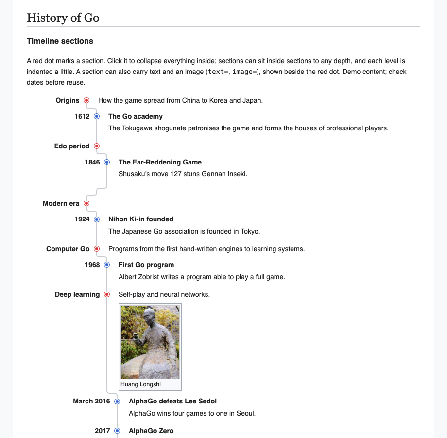

# Wikipedia Timeline

> See it live on [psygo.github.io/wikipedia_timeline](https://psygo.github.io/wikipedia_timeline/)

A vertical event timeline for Wikipedia, built as a template plus TemplateStyles
(no MediaWiki extension, no JavaScript). See [Docs.md](Docs.md) for design notes and next steps.

Tables are still a great of way of displaying timelines, especially when we have multi-column data. The `TimelineRail` component here seems to be better whenever each event contains a lot of text and multi-type data.

<picture>
  <source media="(prefers-color-scheme: dark)" srcset="docs/screenshot-dark.png">
  
</picture>

The timeline with sections (red dots) in the prototype article, in the reader's light or dark theme.

## References

- [Wikipedia Proposal](<https://en.wikipedia.org/wiki/Wikipedia:Village_pump_(proposals)#Timeline_Visual_Component%3E>)
  - [Proposal for Converting the Timeline of AI](https://en.wikipedia.org/wiki/Talk:Timeline_of_artificial_intelligence#Converting_The_Timeline_of_AI_to_a_TimelineRail_Component)
  - [Proposal for Converting the Timeline of First Images of Earth from Space](https://en.wikipedia.org/wiki/Talk:Timeline_of_first_images_of_Earth_from_space#Converting_The_Timeline_of_Images_of_Earth_from_Space_to_a_TimelineRail_Component)
- [Go | Hall of Fame](https://go-hall-of-fame.vercel.app)

## Try the prototype

    open prototype/index.html

`index.html` is a viewer: drag the handles on the left and right edges (or focus one and use the arrow keys)
to change the page width, and use the Theme button (system / light / dark). The timeline switches layout at 640 px.
`article.html` is the mock article itself; `alone.html` shows the timeline alone.
The prototype is also published with GitHub Pages (see `.github/workflows/pages.yml`).

## Try the template (untested on a wiki)

Needs TemplateStyles and ParserFunctions. The templates are the `TimelineRail` family. `template/` holds one
paste-ready file per wiki page:

| Page                                                              | File                                        | Edit by hand?                        |
| ----------------------------------------------------------------- | ------------------------------------------- | ------------------------------------ |
| `Template:TimelineRail/styles.css` (content model: Sanitized CSS) | `template/TimelineRail__styles.css`         | no: copy of `prototype/timeline.css` |
| `Template:TimelineRail/event`                                     | `template/TimelineRail__event.wikitext`     | yes                                  |
| `Template:TimelineRail/gap`                                       | `template/TimelineRail__gap.wikitext`       | yes                                  |
| `Template:TimelineRail/item`                                      | `template/TimelineRail__item.wikitext`      | yes                                  |
| `Template:TimelineRail/section`                                   | `template/TimelineRail__section.wikitext`   | yes                                  |
| `Template:TimelineRail/parallel`                                  | `template/TimelineRail__parallel.wikitext`  | yes                                  |
| `Template:TimelineRail`                                           | `template/TimelineRail.wikitext`            | yes                                  |
| `Template:TimelineRail/doc`                                       | `template/TimelineRail__doc.wikitext`       | no: from `tools/doc_source.wikitext` |
| `Template:TimelineRail/testcases`                                 | `template/TimelineRail__testcases.wikitext` | no: demo text in `tools/build.py`    |

After changing the stylesheet, the doc or the demo, run `python3 tools/build.py` to regenerate the three generated files.
Usage for one event per dot, several events per dot, nested timelines, collapsible items, sections and parallel timelines is in
`tools/doc_source.wikitext` (what becomes the `/doc` page). For a quick start:

    {{TimelineRail
    |{{TimelineRail/item |date=1612 |title=The Go academy |text=Text.}}
    {{TimelineRail/item |date=March 2016 |title=AlphaGo defeats Lee Sedol}}
    }}

## Other packagings

The same stylesheet, class names and behaviour, outside Wikipedia (the stylesheet is copied from `prototype/timeline.css` by `python3 tools/sync_css.py`, which `tools/build.py` also runs):

- [web-component/](web-component/) is a `<timeline-rail>` custom element, no dependencies, no build step, plus separate `<view-switcher>`, `<outline-list>` and `<outline-table>` elements for switching between a timeline, a list and a table.
- [react/](react/) is a set of React components (Vite library build, TypeScript types), with `ViewSwitcher`, `OutlineList` and `OutlineTable` as separate components.
- [lua/](lua/) is `Module:TimelineRail`, a Scribunto module that writes the same markup (with an `outline` entry point that avoids the post-expand size problem); locally tested only.

## Wikipedia pages

Every page the project creates on a wiki, with the file to paste into it. Name a module `.../sandbox` to try it first (the converters
write drafts for the sandbox names); `lua/README.md` has the step by step, and the draft pages are in `drafts/`.

| Page (edit link) | Paste from | What it is | Sandbox copy? |
|---|---|---|---|
| [Module:TimelineRail](https://en.wikipedia.org/w/index.php?title=Module:TimelineRail&action=edit) | [`lua/Module_TimelineRail.lua`](https://github.com/psygo/wikipedia_timeline/blob/main/lua/Module_TimelineRail.lua) | The timeline: `item`, `section`, `event`, `gap`, `rail`, `parallel`, and `outline` (one outline text becomes a whole timeline). | yes |
| [Module:TimelineRail/doc](https://en.wikipedia.org/w/index.php?title=Module:TimelineRail/doc&action=edit) | [`lua/Module_TimelineRail__doc.wikitext`](https://github.com/psygo/wikipedia_timeline/blob/main/lua/Module_TimelineRail__doc.wikitext) | Its documentation. | - |
| [Module:ViewSwitcher](https://en.wikipedia.org/w/index.php?title=Module:ViewSwitcher&action=edit) | [`lua/Module_ViewSwitcher.lua`](https://github.com/psygo/wikipedia_timeline/blob/main/lua/Module_ViewSwitcher.lua) | `{{#invoke:ViewSwitcher|switch ...}}`: several views of one content in a box; `*` or `default=` marks the default view; `@arg` shows an argument as it is; footnotes kept in the default view only. | yes |
| [Module:ViewSwitcher/styles.css](https://en.wikipedia.org/w/index.php?title=Module:ViewSwitcher/styles.css&action=edit) | [`lua/ViewSwitcher__styles.css`](https://github.com/psygo/wikipedia_timeline/blob/main/lua/ViewSwitcher__styles.css) | The button and menu of the switcher (TemplateStyles). | no (the module names this page) |
| [Module:OutlineList](https://en.wikipedia.org/w/index.php?title=Module:OutlineList&action=edit) | [`lua/Module_OutlineList.lua`](https://github.com/psygo/wikipedia_timeline/blob/main/lua/Module_OutlineList.lua) | The outline as a plain bulleted list (a view for the switcher, or alone). | yes |
| [Module:OutlineTable](https://en.wikipedia.org/w/index.php?title=Module:OutlineTable&action=edit) | [`lua/Module_OutlineTable.lua`](https://github.com/psygo/wikipedia_timeline/blob/main/lua/Module_OutlineTable.lua) | The outline as a `wikitable` (a view for the switcher, or alone). | yes |
| [Template:TimelineRail/styles.css](https://en.wikipedia.org/w/index.php?title=Template:TimelineRail/styles.css&action=edit) | [`template/TimelineRail__styles.css`](https://github.com/psygo/wikipedia_timeline/blob/main/template/TimelineRail__styles.css) | The look of the timeline (TemplateStyles); shared by the template and the module. | no |
| [Template:TimelineRail](https://en.wikipedia.org/w/index.php?title=Template:TimelineRail&action=edit), [Template:TimelineRail/item](https://en.wikipedia.org/w/index.php?title=Template:TimelineRail/item&action=edit), [Template:TimelineRail/section](https://en.wikipedia.org/w/index.php?title=Template:TimelineRail/section&action=edit), [Template:TimelineRail/event](https://en.wikipedia.org/w/index.php?title=Template:TimelineRail/event&action=edit), [Template:TimelineRail/gap](https://en.wikipedia.org/w/index.php?title=Template:TimelineRail/gap&action=edit), [Template:TimelineRail/parallel](https://en.wikipedia.org/w/index.php?title=Template:TimelineRail/parallel&action=edit), [Template:TimelineRail/outline](https://en.wikipedia.org/w/index.php?title=Template:TimelineRail/outline&action=edit) | [`lua/template/TimelineRail*.wikitext`](https://github.com/psygo/wikipedia_timeline/blob/main/lua/template) (7 files) | One-line `{{#invoke:TimelineRail|...}}` wrappers, so articles keep the template names. Same page names as the pure-template family in `template/`: use one family or the other. | no |
| [User:Fanaro009/ViewSwitcher.js](https://en.wikipedia.org/w/index.php?title=User:Fanaro009/ViewSwitcher.js&action=edit) | [`userscript/ViewSwitcher.js`](https://github.com/psygo/wikipedia_timeline/blob/main/userscript/ViewSwitcher.js) | The View button for your account only, on its own page (try it here before asking for the gadget). Then add one line, `importScript( 'User:Fanaro009/ViewSwitcher.js' );`, to [User:Fanaro009/common.js](https://en.wikipedia.org/w/index.php?title=User:Fanaro009/common.js&action=edit), the page Wikipedia loads for you automatically. | no |
| [User:Fanaro009/Timeline-toolbar.js](https://en.wikipedia.org/w/index.php?title=User:Fanaro009/Timeline-toolbar.js&action=edit) | [`userscript/Timeline-toolbar.js`](https://github.com/psygo/wikipedia_timeline/blob/main/userscript/Timeline-toolbar.js) | A **Timeline** drop-down in the edit toolbar that inserts skeletons for the templates. Own page, loaded by `importScript( 'User:Fanaro009/Timeline-toolbar.js' );` in `common.js`. | no |
| [User:Fanaro009/Timeline-collapse-all.js](https://en.wikipedia.org/w/index.php?title=User:Fanaro009/Timeline-collapse-all.js&action=edit) | [`userscript/Timeline-collapse-all.js`](https://github.com/psygo/wikipedia_timeline/blob/main/userscript/Timeline-collapse-all.js) | Double-click a dot to collapse or expand the whole timeline. Same way: own page, one `importScript` line in `common.js`. | no |
| [User:Fanaro009/common.js](https://en.wikipedia.org/w/index.php?title=User:Fanaro009/common.js&action=edit) | [`userscript/common.js`](https://github.com/psygo/wikipedia_timeline/blob/main/userscript/common.js) | The three `importScript` lines that load the user scripts above (add them to the page; keep what is already there). | no |
| [MediaWiki:Gadget-ViewSwitcher.js](https://en.wikipedia.org/w/index.php?title=MediaWiki:Gadget-ViewSwitcher.js&action=edit) | [`userscript/ViewSwitcher.js`](https://github.com/psygo/wikipedia_timeline/blob/main/userscript/ViewSwitcher.js) | The View button. For one account: `User:<name>/common.js`. | no (interface administrators) |
| [MediaWiki:Gadgets-definition](https://en.wikipedia.org/w/index.php?title=MediaWiki:Gadgets-definition&action=edit) | (one line: `* ViewSwitcher[default]\|ViewSwitcher.js`) | Switches the gadget on for everyone. | no (interface administrators) |

The test page `lua/Module_TimelineRail__test.wikitext` goes on any user subpage (it calls the sandbox module).

## User script (optional)

`userscript/Timeline-toolbar.js` adds a **Timeline** drop-down to the edit toolbar that inserts
skeletons for the simple, multi-event, parallel and grouped timelines. Copy it to
`User:<YourName>/Timeline-toolbar.js` and add `importScript( 'User:<YourName>/Timeline-toolbar.js' );`
to `User:<YourName>/common.js`. Needs the WikiEditor toolbar. Untested on a live wiki.
`userscript/Timeline-collapse-all.js` (double-click a dot to collapse or expand the whole timeline) and
`userscript/ViewSwitcher.js` (the View button) are installed the same way, each on its own page. `userscript/common.js` is the whole of what goes on `User:Fanaro009/common.js` (the three `importScript` lines).

## Demo on a Wikipedia user subpage

`python3 tools/build.py --sandbox <WikipediaUsername>` writes `sandbox/<username>/` (not tracked): one file per wiki page,
with all template names rewritten to subpages of `User:<username>/Timeline sandbox`, a demo page
`User:<username>/Timeline demo`, and the stylesheet at `Template:<username>/Timeline sandbox/styles.css`
(created by page title; `Special:ChangeContentModel` is limited to admins and template editors).
