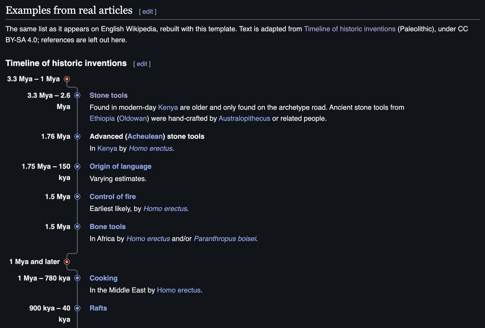

# Wikipedia Timeline

> See it live on [psygo.github.io/wikipedia_timeline](https://psygo.github.io/wikipedia_timeline/)

A vertical event timeline for Wikipedia, built as a template plus TemplateStyles
(no MediaWiki extension, no JavaScript). See [Docs.md](Docs.md) for design notes and next steps.

Tables are still a great of way of displaying timelines, especially when we have multi-column data. The `TimelineRail` component here seems to be better whenever each event contains a lot of text and multi-type data.

<picture>
  <source media="(prefers-color-scheme: dark)" srcset="docs/screenshot-dark.png">
  
</picture>

The timeline with sections (red dots) in the prototype article, in the reader's light or dark theme.

## References

- Wikipedia
  - [Wikipedia Timeline Proposal](<https://en.wikipedia.org/wiki/Wikipedia:Village_pump_(proposals)#Timeline_Visual_Component%3E>)
    - [Proposal for Converting the Timeline of AI](https://en.wikipedia.org/wiki/Talk:Timeline_of_artificial_intelligence#Converting_The_Timeline_of_AI_to_a_TimelineRail_Component)
    - [Proposal for Converting the Timeline of First Images of Earth from Space](https://en.wikipedia.org/wiki/Talk:Timeline_of_first_images_of_Earth_from_space#Converting_The_Timeline_of_Images_of_Earth_from_Space_to_a_TimelineRail_Component)
  - [Wikipedia `ViewSwitcher` Proposal](https://en.wikipedia.org/wiki/Wikipedia_talk:Gadget#ViewSwitcher_for_Timelines)
- Other Websites
  - [Go | Hall of Fame](https://go-hall-of-fame.vercel.app)
  - [A Wikipedia Timeline Component | neofanaro.io](https://www.neofanaro.io/articles/wikipedia-timeline)

## Try the prototype

    open prototype/index.html

`index.html` is a viewer: drag the handles on the left and right edges (or focus one and use the arrow keys)
to change the page width, and use the Theme button (system / light / dark). The timeline switches layout at 640 px.
`article.html` is the mock article itself; `alone.html` shows the timeline alone.
The prototype is also published with GitHub Pages (see `.github/workflows/pages.yml`).

## Try the template (untested on a wiki)

Needs TemplateStyles and ParserFunctions. The templates are the `TimelineRail` family. `template/` holds one
paste-ready file per wiki page:

<table>
  <thead>
    <tr><th>Page</th><th>File</th><th>Edit by hand?</th></tr>
  </thead>
  <tbody>
    <tr>
      <td><code>Template:TimelineRail/styles.css</code> (content model: Sanitized CSS)</td>
      <td><code>template/TimelineRail__styles.css</code></td>
      <td>no: copy of <code>prototype/timeline.css</code></td>
    </tr>
    <tr>
      <td><code>Template:TimelineRail/event</code></td>
      <td><code>template/TimelineRail__event.wikitext</code></td>
      <td>yes</td>
    </tr>
    <tr>
      <td><code>Template:TimelineRail/gap</code></td>
      <td><code>template/TimelineRail__gap.wikitext</code></td>
      <td>yes</td>
    </tr>
    <tr>
      <td><code>Template:TimelineRail/item</code></td>
      <td><code>template/TimelineRail__item.wikitext</code></td>
      <td>yes</td>
    </tr>
    <tr>
      <td><code>Template:TimelineRail/section</code></td>
      <td><code>template/TimelineRail__section.wikitext</code></td>
      <td>yes</td>
    </tr>
    <tr>
      <td><code>Template:TimelineRail/parallel</code></td>
      <td><code>template/TimelineRail__parallel.wikitext</code></td>
      <td>yes</td>
    </tr>
    <tr>
      <td><code>Template:TimelineRail</code></td>
      <td><code>template/TimelineRail.wikitext</code></td>
      <td>yes</td>
    </tr>
    <tr>
      <td><code>Template:TimelineRail/doc</code></td>
      <td><code>template/TimelineRail__doc.wikitext</code></td>
      <td>no: from <code>tools/doc_source.wikitext</code></td>
    </tr>
    <tr>
      <td><code>Template:TimelineRail/testcases</code></td>
      <td><code>template/TimelineRail__testcases.wikitext</code></td>
      <td>no: demo text in <code>tools/build.py</code></td>
    </tr>
  </tbody>
</table>

After changing the stylesheet, the doc or the demo, run `python3 tools/build.py` to regenerate the three generated files.
Usage for one event per dot, several events per dot, nested timelines, collapsible items, sections and parallel timelines is in
`tools/doc_source.wikitext` (what becomes the `/doc` page). For a quick start:

    {{TimelineRail
    |{{TimelineRail/item |date=1612 |title=The Go academy |text=Text.}}
    {{TimelineRail/item |date=March 2016 |title=AlphaGo defeats Lee Sedol}}
    }}

## Other packagings

The same stylesheet, class names and behaviour, outside Wikipedia (the stylesheet is copied from `prototype/timeline.css` by `python3 tools/sync_css.py`, which `tools/build.py` also runs):

- [web-component/](web-component/) is a `<timeline-rail>` custom element, no dependencies, no build step, plus separate `<view-switcher>`, `<outline-list>` and `<outline-table>` elements for switching between a timeline, a list and a table.
- [react/](react/) is a set of React components (Vite library build, TypeScript types), with `ViewSwitcher`, `OutlineList` and `OutlineTable` as separate components.
- [lua/](lua/) is `Module:TimelineRail`, a Scribunto module that writes the same markup (with an `outline` entry point that avoids the post-expand size problem); locally tested only.

## Wikipedia pages

Every page the project creates on a wiki, with the file to paste into it. Name a module `.../sandbox` to try it first (the converters
write drafts for the sandbox names); `lua/README.md` has the step by step, and the draft pages are in `drafts/`.

<table>
  <thead>
    <tr><th>Page (edit link)</th><th>Paste from</th><th>What it is</th><th>Sandbox copy?</th></tr>
  </thead>
  <tbody>
    <tr>
      <td><a href="https://en.wikipedia.org/w/index.php?title=Module:TimelineRail&amp;action=edit">Module:TimelineRail</a></td>
      <td><a href="https://github.com/psygo/wikipedia_timeline/blob/main/lua/Module_TimelineRail.lua"><code>lua/Module_TimelineRail.lua</code></a></td>
      <td>The timeline: <code>item</code>, <code>section</code>, <code>event</code>, <code>gap</code>, <code>rail</code>, <code>parallel</code>, and <code>outline</code> (one outline text becomes a whole timeline).</td>
      <td>yes</td>
    </tr>
    <tr>
      <td><a href="https://en.wikipedia.org/w/index.php?title=Module:TimelineRail/doc&amp;action=edit">Module:TimelineRail/doc</a></td>
      <td><a href="https://github.com/psygo/wikipedia_timeline/blob/main/lua/Module_TimelineRail__doc.wikitext"><code>lua/Module_TimelineRail__doc.wikitext</code></a></td>
      <td>Its documentation.</td>
      <td>-</td>
    </tr>
    <tr>
      <td><a href="https://en.wikipedia.org/w/index.php?title=Module:ViewSwitcher&amp;action=edit">Module:ViewSwitcher</a></td>
      <td><a href="https://github.com/psygo/wikipedia_timeline/blob/main/lua/Module_ViewSwitcher.lua"><code>lua/Module_ViewSwitcher.lua</code></a></td>
      <td><code>{{#invoke:ViewSwitcher                                                                                                                                                                                                                                                                                                                    \| switch ...}}</code>: several views of one content in a box; <code>\*</code>or<code>default=</code>marks the default view;<code>@arg</code> shows an argument as it is; footnotes kept in the default view only.</td>
      <td>yes</td>
    </tr>
    <tr>
      <td><a href="https://en.wikipedia.org/w/index.php?title=Module:ViewSwitcher/styles.css&amp;action=edit">Module:ViewSwitcher/styles.css</a></td>
      <td><a href="https://github.com/psygo/wikipedia_timeline/blob/main/lua/ViewSwitcher__styles.css"><code>lua/ViewSwitcher__styles.css</code></a></td>
      <td>The button and menu of the switcher (TemplateStyles).</td>
      <td>no (the module names this page)</td>
    </tr>
    <tr>
      <td><a href="https://en.wikipedia.org/w/index.php?title=Module:OutlineList&amp;action=edit">Module:OutlineList</a></td>
      <td><a href="https://github.com/psygo/wikipedia_timeline/blob/main/lua/Module_OutlineList.lua"><code>lua/Module_OutlineList.lua</code></a></td>
      <td>The outline as a plain bulleted list (a view for the switcher, or alone).</td>
      <td>yes</td>
    </tr>
    <tr>
      <td><a href="https://en.wikipedia.org/w/index.php?title=Module:OutlineTable&amp;action=edit">Module:OutlineTable</a></td>
      <td><a href="https://github.com/psygo/wikipedia_timeline/blob/main/lua/Module_OutlineTable.lua"><code>lua/Module_OutlineTable.lua</code></a></td>
      <td>The outline as a <code>wikitable</code> (a view for the switcher, or alone).</td>
      <td>yes</td>
    </tr>
    <tr>
      <td><a href="https://en.wikipedia.org/w/index.php?title=Template:TimelineRail/styles.css&amp;action=edit">Template:TimelineRail/styles.css</a></td>
      <td><a href="https://github.com/psygo/wikipedia_timeline/blob/main/template/TimelineRail__styles.css"><code>template/TimelineRail__styles.css</code></a></td>
      <td>The look of the timeline (TemplateStyles); shared by the template and the module.</td>
      <td>no</td>
    </tr>
    <tr>
      <td><a href="https://en.wikipedia.org/w/index.php?title=Template:TimelineRail&amp;action=edit">Template:TimelineRail</a>, <a href="https://en.wikipedia.org/w/index.php?title=Template:TimelineRail/item&amp;action=edit">Template:TimelineRail/item</a>, <a href="https://en.wikipedia.org/w/index.php?title=Template:TimelineRail/section&amp;action=edit">Template:TimelineRail/section</a>, <a href="https://en.wikipedia.org/w/index.php?title=Template:TimelineRail/event&amp;action=edit">Template:TimelineRail/event</a>, <a href="https://en.wikipedia.org/w/index.php?title=Template:TimelineRail/gap&amp;action=edit">Template:TimelineRail/gap</a>, <a href="https://en.wikipedia.org/w/index.php?title=Template:TimelineRail/parallel&amp;action=edit">Template:TimelineRail/parallel</a>, <a href="https://en.wikipedia.org/w/index.php?title=Template:TimelineRail/outline&amp;action=edit">Template:TimelineRail/outline</a></td>
      <td><a href="https://github.com/psygo/wikipedia_timeline/blob/main/lua/template"><code>lua/template/TimelineRail*.wikitext</code></a> (7 files)</td>
      <td>One-line <code>{{#invoke:TimelineRail                                                                                                                                                                                                                                                                                                           \| ...}}</code>wrappers, so articles keep the template names. Same page names as the pure-template family in<code>template/</code>: use one family or the other.</td>
      <td>no</td>
    </tr>
    <tr>
      <td><a href="https://en.wikipedia.org/w/index.php?title=User:Fanaro009/ViewSwitcher.js&amp;action=edit">User:Fanaro009/ViewSwitcher.js</a></td>
      <td><a href="https://github.com/psygo/wikipedia_timeline/blob/main/userscript/ViewSwitcher.js"><code>userscript/ViewSwitcher.js</code></a></td>
      <td>The View button for your account only, on its own page (try it here before asking for the gadget). Then add one line, <code>importScript( 'User:Fanaro009/ViewSwitcher.js' );</code>, to <a href="https://en.wikipedia.org/w/index.php?title=User:Fanaro009/common.js&amp;action=edit">User:Fanaro009/common.js</a>, the page Wikipedia loads for you automatically.</td>
      <td>no</td>
    </tr>
    <tr>
      <td><a href="https://en.wikipedia.org/w/index.php?title=User:Fanaro009/Timeline-toolbar.js&amp;action=edit">User:Fanaro009/Timeline-toolbar.js</a></td>
      <td><a href="https://github.com/psygo/wikipedia_timeline/blob/main/userscript/Timeline-toolbar.js"><code>userscript/Timeline-toolbar.js</code></a></td>
      <td>A **Timeline** drop-down in the edit toolbar that inserts skeletons for the templates. Own page, loaded by <code>importScript( 'User:Fanaro009/Timeline-toolbar.js' );</code> in <code>common.js</code>.</td>
      <td>no</td>
    </tr>
    <tr>
      <td><a href="https://en.wikipedia.org/w/index.php?title=User:Fanaro009/Timeline-collapse-all.js&amp;action=edit">User:Fanaro009/Timeline-collapse-all.js</a></td>
      <td><a href="https://github.com/psygo/wikipedia_timeline/blob/main/userscript/Timeline-collapse-all.js"><code>userscript/Timeline-collapse-all.js</code></a></td>
      <td>Double-click a dot to collapse or expand the whole timeline. Same way: own page, one <code>importScript</code> line in <code>common.js</code>.</td>
      <td>no</td>
    </tr>
    <tr>
      <td><a href="https://en.wikipedia.org/w/index.php?title=User:Fanaro009/common.js&amp;action=edit">User:Fanaro009/common.js</a></td>
      <td><a href="https://github.com/psygo/wikipedia_timeline/blob/main/userscript/common.js"><code>userscript/common.js</code></a></td>
      <td>The three <code>importScript</code> lines that load the user scripts above (add them to the page; keep what is already there).</td>
      <td>no</td>
    </tr>
    <tr>
      <td><a href="https://en.wikipedia.org/w/index.php?title=MediaWiki:Gadget-ViewSwitcher.js&amp;action=edit">MediaWiki:Gadget-ViewSwitcher.js</a></td>
      <td><a href="https://github.com/psygo/wikipedia_timeline/blob/main/userscript/ViewSwitcher.js"><code>userscript/ViewSwitcher.js</code></a></td>
      <td>The View button. For one account: <code>User:<name>/common.js</code>.</td>
      <td>no (interface administrators)</td>
    </tr>
    <tr>
      <td><a href="https://en.wikipedia.org/w/index.php?title=MediaWiki:Gadgets-definition&amp;action=edit">MediaWiki:Gadgets-definition</a></td>
      <td>(one line: <code>\* ViewSwitcher[default]\\                                                                                                 | ViewSwitcher.js</code>)</td>
      <td>Switches the gadget on for everyone.</td>
      <td>no (interface administrators)</td>
    </tr>
  </tbody>
</table>

The test page `lua/Module_TimelineRail__test.wikitext` goes on any user subpage (it calls the sandbox module).

## Wikipedia pages on pt.wikipedia.org

The same modules and styles, copied to the Portuguese Wikipedia (each wiki has its own copy: modules cannot be called across wikis).
`Module:` and `Template:` also work there as `Módulo:` and `Predefinição:`. Paste in this order; the article comes last.

<table>
  <thead>
    <tr><th>Page on pt.wikipedia.org (edit link)</th><th>Paste from</th><th>What it is</th></tr>
  </thead>
  <tbody>
    <tr>
      <td><a href="https://pt.wikipedia.org/w/index.php?title=M%C3%B3dulo:TimelineRail&amp;action=edit">Módulo:TimelineRail</a></td>
      <td><a href="https://github.com/psygo/wikipedia_timeline/blob/main/lua/Module_TimelineRail.lua"><code>lua/Module_TimelineRail.lua</code></a></td>
      <td>The timeline</td>
    </tr>
    <tr>
      <td><a href="https://pt.wikipedia.org/w/index.php?title=Predefini%C3%A7%C3%A3o:TimelineRail/styles.css&amp;action=edit">Predefinição:TimelineRail/styles.css</a></td>
      <td><a href="https://github.com/psygo/wikipedia_timeline/blob/main/template/TimelineRail__styles.css"><code>template/TimelineRail__styles.css</code></a></td>
      <td>Its look</td>
    </tr>
    <tr>
      <td><a href="https://pt.wikipedia.org/w/index.php?title=M%C3%B3dulo:OutlineList&amp;action=edit">Módulo:OutlineList</a></td>
      <td><a href="https://github.com/psygo/wikipedia_timeline/blob/main/lua/Module_OutlineList.lua"><code>lua/Module_OutlineList.lua</code></a></td>
      <td>The List view</td>
    </tr>
    <tr>
      <td><a href="https://pt.wikipedia.org/w/index.php?title=M%C3%B3dulo:OutlineTable&amp;action=edit">Módulo:OutlineTable</a></td>
      <td><a href="https://github.com/psygo/wikipedia_timeline/blob/main/lua/Module_OutlineTable.lua"><code>lua/Module_OutlineTable.lua</code></a></td>
      <td>The Table view</td>
    </tr>
    <tr>
      <td><a href="https://pt.wikipedia.org/w/index.php?title=M%C3%B3dulo:ViewSwitcher&amp;action=edit">Módulo:ViewSwitcher</a></td>
      <td><a href="https://github.com/psygo/wikipedia_timeline/blob/main/lua/Module_ViewSwitcher.lua"><code>lua/Module_ViewSwitcher.lua</code></a></td>
      <td>The views and their dropdown</td>
    </tr>
    <tr>
      <td><a href="https://pt.wikipedia.org/w/index.php?title=M%C3%B3dulo:ViewSwitcher/styles.css&amp;action=edit">Módulo:ViewSwitcher/styles.css</a></td>
      <td><a href="https://github.com/psygo/wikipedia_timeline/blob/main/lua/ViewSwitcher__styles.css"><code>lua/ViewSwitcher__styles.css</code></a></td>
      <td>The dropdown's look</td>
    </tr>
    <tr>
      <td><a href="https://pt.wikipedia.org/w/index.php?title=Linha_do_tempo_do_Go&amp;action=edit">Linha do tempo do Go</a></td>
      <td><a href="https://github.com/psygo/wikipedia_timeline/blob/main/drafts/Linha_do_tempo_do_Go__pt.wikitext"><code>drafts/Linha_do_tempo_do_Go__pt.wikitext</code></a></td>
      <td>The Portuguese (Brazil) Timeline of Go. <code>python3 tools/convert_go.py --lang=pt</code> makes it; <code>--no-youtube</code> leaves out the YouTube reference (a new account cannot add YouTube links there)</td>
    </tr>
    <tr>
      <td><a href="https://pt.wikipedia.org/w/index.php?title=Usu%C3%A1rio:SEU_NOME/ViewSwitcher.js&amp;action=edit">Usuário:SEU_NOME/ViewSwitcher.js</a> (optional)</td>
      <td><a href="https://github.com/psygo/wikipedia_timeline/blob/main/userscript/ViewSwitcher.js"><code>userscript/ViewSwitcher.js</code></a></td>
      <td>The View button, for you only (replace <code>SEU_NOME</code> with your username, then <code>importScript</code> it from your <code>common.js</code>)</td>
    </tr>
  </tbody>
</table>

## User script (optional)

`userscript/Timeline-toolbar.js` adds a **Timeline** drop-down to the edit toolbar that inserts
skeletons for the simple, multi-event, parallel and grouped timelines. Copy it to
`User:<YourName>/Timeline-toolbar.js` and add `importScript( 'User:<YourName>/Timeline-toolbar.js' );`
to `User:<YourName>/common.js`. Needs the WikiEditor toolbar. Untested on a live wiki.
`userscript/Timeline-collapse-all.js` (double-click a dot to collapse or expand the whole timeline) and
`userscript/ViewSwitcher.js` (the View button) are installed the same way, each on its own page. `userscript/common.js` is the whole of what goes on `User:Fanaro009/common.js` (the three `importScript` lines).

## Demo on a Wikipedia user subpage

`python3 tools/build.py --sandbox <WikipediaUsername>` writes `sandbox/<username>/` (not tracked): one file per wiki page,
with all template names rewritten to subpages of `User:<username>/Timeline sandbox`, a demo page
`User:<username>/Timeline demo`, and the stylesheet at `Template:<username>/Timeline sandbox/styles.css`
(created by page title; `Special:ChangeContentModel` is limited to admins and template editors).
